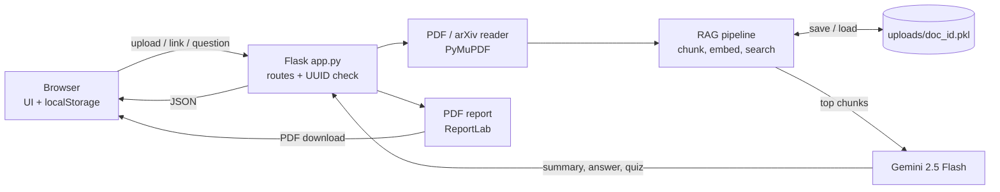

# PaperLens — Document & Research Paper Analyzer

> **Read less. Understand more.** Fast AI-powered document analysis, conversational RAG question-answering, dynamic interactive quizzes, and publication-ready PDF reporting.

---

## Table of Contents
- [About the Project](#about-the-project)
- [Key Features](#key-features)
- [System Architecture](#system-architecture)
- [User Flow](#user-flow)
- [Project Structure](#project-structure)
- [Tech Stack](#tech-stack)
- [Getting Started](#getting-started)
  - [Prerequisites](#prerequisites)
  - [Installation](#installation)
  - [Environment Configuration](#environment-configuration)
  - [Running the Application](#running-the-application)
- [API Reference](#api-reference)
- [Storage, Caching & Lifecycle Management](#storage-caching--lifecycle-management)
- [Security & Safety](#security--safety)
- [License](#license)

---

## About the Project

**PaperLens** is an intelligent, privacy-conscious document and academic paper comprehension engine. Dense research papers and complex PDF reports often take hours to digest. PaperLens automates this process by transforming raw files and arXiv publications into structured, high-value insights in seconds.

Unlike generic PDF summarizers, PaperLens operates with document-type awareness:
- **Research Papers**: Automatically detects paper structure and generates academic metadata, cited references, and a synchronized 5-section breakdown (Executive Summary, Methodology, Datasets, Results, and Limitations).
- **General Documents**: Skips inapplicable academic sections, allowing users to jump directly into context-aware chat and quizzes.

PaperLens utilizes a local embedding model (`all-MiniLM-L6-v2`) paired with vector similarity search and a single-call **Gemini 2.5 Flash** pipeline to deliver low-latency analysis without redundant LLM calls.

---

## Key Features

### 1. PDF Upload and arXiv Links
- Upload a PDF (up to 20MB) or paste an arXiv URL or ID.
- arXiv links fetch the abstract, authors, and PDF automatically.
- The app detects whether the file is a research paper or a normal document and adjusts the page.

### 2. 5-Section Breakdown (research papers)
One Gemini call produces short bullet points for:
- **Summary:** the problem and main contribution.
- **Methodology:** model, method, and training setup.
- **Datasets Used:** benchmarks and data.
- **Key Results:** main numbers and comparisons.
- **Limitations & Future Work:** weaknesses and next steps.

### 3. Chat with the Document
- Chat-style Q&A: your questions on the right, answers on the left, with a Copy button.
- Follow-up questions work, because the last 6 messages are sent as context.
- "Thinking..." indicator while waiting, and a "Clear chat" button.

### 4. Quiz
- Opens in its own view (`#quiz`), separate from the document.
- 5 multiple-choice questions per round, made from different parts of the document.
- Instant green/red feedback with a one-line explanation.
- Final score with a level: 80%+ strong, 50-79% fair, below 50% needs revision.
- Unfinished quizzes are saved. You can Resume or Start Over.
- "5 more questions" gives a new round that avoids repeating earlier questions.

### 5. PDF Report Export
- Download a PDF with the metadata, abstract, all 5 sections, and your Q&A chat.

### 6. Multiple Documents Safely
- Each document gets its own ID and its own cache file, so documents never overwrite each other.
- Old files are deleted after 24 hours, and when you click "Analyze another". Details are in the Storage section below.
---

## System Architecture



---

## User Flow

```text
User opens PaperLens
        │
        ▼
Upload screen: PDF file or arXiv link
        │
        ▼
Backend reads file, detects type, builds analysis
        │
        ▼
   Is it a research paper?
   ├── Yes ─► Results: metadata + 5 section cards + references
   └── No  ─► Results: title + Q&A only
        │
        ▼
Results page. User can:
   ├── Chat with the document (follow-ups work)
   ├── Download PDF report
   ├── Analyze another ─► delete server file + clear browser data ─► Upload screen
   └── Take Quiz
            │
            ▼
      Quiz view (#quiz)
            │
            ▼
   Quiz in progress?
   ├── Yes ─► Resume Quiz / Start Over
   └── No  ─► Start new 5-question quiz
            │
            ▼
   Answer questions, get instant feedback
   ├── Exit Quiz ─► save progress ─► back to document (#document)
   └── Finish all 5
            │
            ▼
   Score + running total + level
   ├── 5 more questions ─► new quiz round
   └── Back to document
```

---

## Project Structure

```text
research-rag/
├── app.py                     # Flask application entry point and REST routes
├── requirements.txt           # Python dependencies
├── .env.example               # Template for environment variables
├── .env                       # Local environment configuration (API keys)
├── LICENSE                    # MIT License
├── README.md                  # Project documentation
│
├── fonts/                     # Bundled TrueType fonts for PDF generation
│   ├── DejaVuSans.ttf
│   └── DejaVuSans-Bold.ttf
│
├── static/
│   ├── favicon.svg            # Custom PaperLens vector brand icon
│   ├── css/
│   │   └── style.css          # Modern responsive styling, theme variables, animations
│   └── js/
│       └── app.js             # Client state, routing, chat thread, and quiz logic
│
├── templates/
│   └── index.html             # Single-page UI template (Landing, Results, Quiz)
│
├── uploads/                   # Ephemeral document cache store (UUID-keyed .pkl files)
│
└── utils/
    ├── __init__.py
    ├── arxiv_fetcher.py       # arXiv Atom API client and remote PDF streamer
    ├── pdf_processor.py       # PyMuPDF text parser, layout analyzer, and classifier
    ├── pdf_generator.py       # ReportLab PDF report builder with Unicode support
    ├── rag_pipeline.py        # Vector embeddings, retrieval, cache manager, and Gemini LLM prompts
    └── validator.py           # Input sanitization and format validators
```

---

## Tech Stack

| Domain | Technology / Library | Description |
|---|---|---|
| **Backend Framework** | [Flask 3.0+](https://flask.palletsprojects.com/) | Lightweight WSGI web application server |
| **LLM Inference** | [Google Gemini 2.5 Flash](https://ai.google.dev/) | High-speed LLM for structured extraction, Q&A, and quiz synthesis |
| **Embeddings** | [SentenceTransformers](https://sbert.net/) (`all-MiniLM-L6-v2`) | Local 384-dimensional dense semantic vectors (CPU optimized) |
| **Vector Search** | [NumPy](https://numpy.org/) & [Scikit-learn](https://scikit-learn.org/) | In-memory cosine similarity search |
| **PDF Parsing** | [PyMuPDF (Fitz)](https://pymupdf.readthedocs.io/) | High-throughput PDF text, metadata, and font layout extraction |
| **PDF Generation** | [ReportLab 4.0+](https://www.reportlab.com/) | Programmatic PDF document compilation with TrueType font mapping |
| **Frontend** | HTML5, CSS3, Vanilla JavaScript (ES6+) | Dependency-free, modern interface with CSS variables and hash routing |
| **Typography** | Inter & Lora (Google Fonts), DejaVu Sans | Typographic pairing for technical readability and academic elegance |

---

## Getting Started

### Prerequisites
- **Python 3.10** or higher installed on your machine.
- A **Google Gemini API Key** (available free from [Google AI Studio](https://aistudio.google.com/)).

### Installation

1. **Clone the repository:**
   ```bash
   git clone https://github.com/Aqifcodes/paperlens.git
   cd paperlens
   ```

2. **Create and activate a virtual environment:**
   - **Linux / macOS:**
     ```bash
     python3 -m venv .venv
     source .venv/bin/activate
     ```
   - **Windows (PowerShell):**
     ```powershell
     python -m venv .venv
     .venv\Scripts\Activate.ps1
     ```

3. **Install dependencies:**
   ```bash
   pip install -r requirements.txt
   ```

### Environment Configuration

1. Copy the sample environment file:
   ```bash
   cp .env.example .env
   ```
2. Open `.env` and insert your Gemini API Key:
   ```env
   GEMINI_API_KEY=YourActualKeyHere
   GEMINI_MODEL=gemini-2.5-flash
   ```

### Running the Application

1. **Start the Flask server:**
   ```bash
   python app.py
   ```
2. **Access the web interface:**
   Open your browser and navigate to:
   ```text
   http://127.0.0.1:5000
   ```

---

## API Reference

### `POST /process`
Analyzes an uploaded PDF or an arXiv URL.
- **Payload (`multipart/form-data`)**:
  - `input_type`: `"file"` or `"link"`
  - `file`: PDF file blob (if `input_type` is `"file"`)
  - `url`: arXiv URL or ID string (if `input_type` is `"link"`)
- **Response (`application/json`)**:
  ```json
  {
    "success": true,
    "doc_id": "9b1deb4d-3b7d-4bad-9bdd-2b0d7b3dcb6d",
    "data": {
      "doc_id": "9b1deb4d-3b7d-4bad-9bdd-2b0d7b3dcb6d",
      "is_paper": true,
      "metadata": {
        "title": "Attention Is All You Need",
        "authors": "Vaswani et al.",
        "abstract": "...",
        "references": ["..."]
      },
      "summary": "...",
      "methodology": "...",
      "dataset": "...",
      "results": "...",
      "limitations": "..."
    }
  }
  ```

### `POST /ask`
Submits a question to the conversational RAG engine.
- **Payload (`application/json`)**:
  ```json
  {
    "doc_id": "9b1deb4d-3b7d-4bad-9bdd-2b0d7b3dcb6d",
    "question": "What optimizer was used during training?",
    "chat_history": [
      { "role": "user", "content": "How many layers are in the transformer?" },
      { "role": "assistant", "content": "- 6 encoder layers and 6 decoder layers." }
    ]
  }
  ```
- **Response (`application/json`)**:
  ```json
  {
    "answer": "- Adam optimizer with beta_1 = 0.9, beta_2 = 0.98, and epsilon = 1e-9.\n- Learning rate varied with a warmup schedule."
  }
  ```

### `POST /quiz`
Generates 5 dynamic multiple-choice questions based on document excerpts.
- **Payload (`application/json`)**:
  ```json
  {
    "doc_id": "9b1deb4d-3b7d-4bad-9bdd-2b0d7b3dcb6d",
    "previous_questions": ["What optimizer was used?"]
  }
  ```
- **Response (`application/json`)**:
  ```json
  {
    "success": true,
    "questions": [
      {
        "question": "What is the primary advantage of the self-attention mechanism?",
        "options": [
          "Eliminates recurrence and enables parallel computation",
          "Reduces total parameters to zero",
          "Replaces convolutional networks in computer vision",
          "Increases training step latency"
        ],
        "correct_index": 0,
        "explanation": "Self-attention removes sequential dependency, allowing full sequence parallelization."
      }
    ]
  }
  ```

### `POST /download`
Returns a PDF report. Send the analysis data and `qa_history` as JSON.

### `POST /delete-doc`
Deletes a document's cache file and memory entry. Send `{"doc_id": "..."}`. Returns `{"success": true}`.
---

## Storage and Cleanup

- **Per-document ID:** each document gets a UUID. Its text chunks and embeddings are saved in `uploads/<doc_id>.pkl`.
- **Memory cache:** the last 5 documents are kept in RAM. Others reload from disk when needed.
- **Auto cleanup:** files older than 24 hours are deleted on server start and on each new upload. At most 50 files are kept. "Analyze another" deletes the document right away.
- **Browser storage:** summary, chat, and in-progress quiz are saved in `localStorage`, so a refresh keeps them.
- **Pickle note:** cache files are Python pickle files. Only run PaperLens on a machine where nobody else can write to `uploads/`.

---

## Security

- Every `doc_id` must be a valid UUID v4. Anything else (like `../../`) gets HTTP 400.
- Uploads are limited to 20MB, and the uploaded PDF is deleted right after text is read.
- File names are sanitized, and arXiv inputs are checked with strict patterns.
---


## License

This project is shared for viewing only. See the [LICENSE](LICENSE) file for details.
